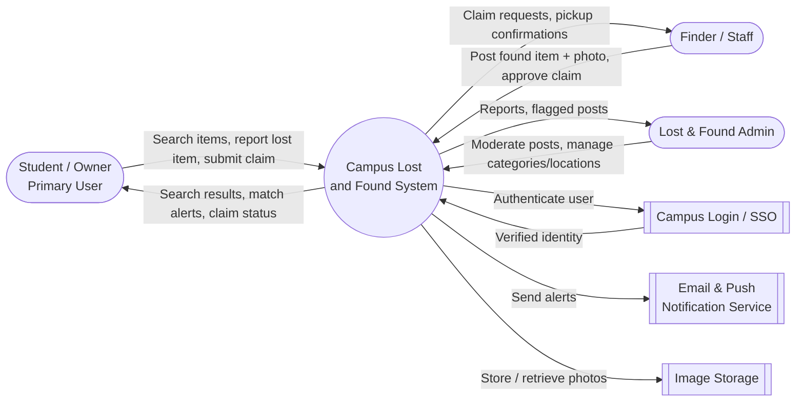
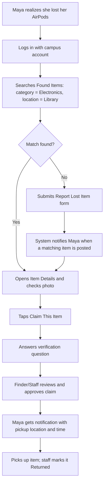
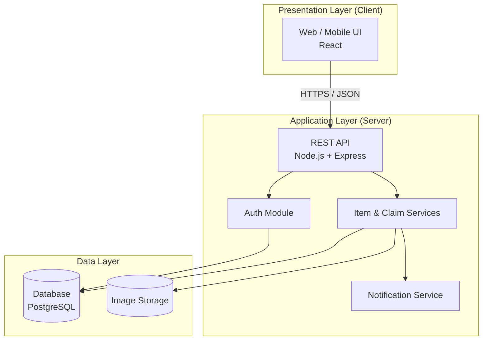

# Campus Lost and Found

**Product Goal:** Help students, faculty, and staff quickly report lost items, post found items, and get them back to their owners through one simple campus-wide app — reducing the time items sit unclaimed at scattered campus offices.

---

## Prototype

**Figma (public link):** [Campus Lost and Found Prototype](https://www.figma.com/make/FD7JF8uE3g1WDm93VYjuob/Campus-Lost-and-Found-Prototype?t=exsNpSs5asI0SRqj-1)

The prototype was designed in Figma using a user-centered approach. Every persona, diagram, screen, and flow below supports the Product Goal: getting lost items back to their owners quickly.

### 1. Personas

**Primary user — Maya Rodriguez, the Student Who Lost Something**
- **Age / Role:** 20, sophomore, commutes to campus four days a week
- **Tech comfort:** High; uses her phone for almost everything
- **Goal:** Find her lost AirPods / student ID / water bottle fast, without walking to multiple offices
- **Frustrations:** Doesn't know where to look first; lost-and-found boxes are spread across buildings; no way to know if someone has already turned her item in
- **Needs from the app:** Search found items by category, location, and date; post a "lost" report; get notified when a matching item is found; claim it easily

**Secondary user — James Carter, the Finder / Front Desk Staff**
- **Age / Role:** 34, front-desk staff at the library (also represents students who find items)
- **Tech comfort:** Medium
- **Goal:** Log found items quickly and hand them back to the right person
- **Frustrations:** Paper logs get messy; hard to verify that the person claiming an item actually owns it
- **Needs from the app:** A fast "post found item" form with photo upload; a way to review and approve claims; mark items as returned

### 2. Context Diagram

The context diagram shows the Campus Lost and Found system and the external actors it interacts with.

### 3. UI — Key Screens

The following key screens were designed in Figma (see link above):

| Screen | Purpose |
|---|---|
| **Login** | Sign in with campus credentials so posts and claims are tied to real users |
| **Home / Browse** | Shows recently found items with search bar and filters (category, location, date) |
| **Item Details** | Photo, description, where/when it was found, and a **Claim This Item** button |
| **Report Lost Item** | Form for owners to describe what they lost so the system can alert them of matches |
| **Post Found Item** | Form with photo upload, category, location found, and pickup location |
| **Claim Form** | Owner answers a verification question (e.g., describe a unique detail) |
| **My Items / Notifications** | Tracks the user's lost reports, claims, and match alerts |

### 4. UX — Primary User Journey (Maya recovers her lost item)

**Important tasks the primary user accomplishes:** searching found items, reporting a lost item, claiming an item with verification, and receiving pickup notifications — all supporting the goal of getting items back fast.

---

## Architecture

The Campus Lost and Found app uses a **client–server architecture** with a **layered (three-tier) design**.

**Layers**
1. **Presentation layer (client):** The user interface built from the Figma designs. It handles screens, forms, and displaying results. It never talks to the database directly; it only calls the API.
2. **Application layer (server):** A REST API that holds the business logic:
   - *Auth module* – login with campus credentials, session/token handling
   - *Item service* – create, search, and update lost and found posts
   - *Claim service* – submit claims, verify ownership, approve/deny, mark returned
   - *Notification service* – sends email/push alerts when a match is found or a claim is approved
3. **Data layer:** A relational database storing Users, Items (lost/found), Claims, and Locations, plus a separate storage service for item photos.

**Why this structure:** Separating the layers keeps the UI, business rules, and data independent, so each part can be built and tested on its own (see Test Plan), and the client could later be swapped for a mobile app without changing the server.

---

## Test Plan

We will use **four categories of testing**: unit, integration, system (end-to-end), and usability.

### 1. Unit Testing
Tests individual functions and components in isolation.
- **Tools:** Jest (server and client), React Testing Library (UI components)

| ID | Test Case | Expected Result |
|---|---|---|
| U1 | Validate "Post Found Item" form with missing required fields | Form shows error and does not submit |
| U2 | Search filter by category returns only that category | Only matching items returned |
| U3 | Claim status changes from Pending → Approved | Status updates correctly |
| U4 | Date filter rejects a future date | Validation error shown |

### 2. Integration Testing
Tests that layers and services work together (API ↔ database ↔ notification service).
- **Tools:** Jest + Supertest against a test database

| ID | Test Case | Expected Result |
|---|---|---|
| I1 | `POST /items` with photo saves item to DB and image to storage | 201 Created; item retrievable via `GET /items/:id` |
| I2 | Approving a claim triggers a notification | Notification service called with owner's email |
| I3 | Unauthenticated request to `POST /claims` | 401 Unauthorized |

### 3. System / End-to-End Testing
Tests complete user journeys through the real UI, following the UX flow above.
- **Tools:** Cypress or Playwright

| ID | Scenario | Expected Result |
|---|---|---|
| S1 | Maya logs in, searches, claims an item, and sees pickup notification | Full flow completes with no errors |
| S2 | Finder posts a found item; it appears on Browse screen | New item visible to other users |
| S3 | Owner reports a lost item, then a matching found item is posted | Owner receives match alert |

### 4. Usability Testing
Checks that real users can complete key tasks using the Figma prototype and later the working app.
- **Method:** 3–5 students complete tasks while thinking aloud
- **Tasks:** Find a lost item, report a lost item, claim an item
- **Success criteria:** Each task completed in under 2 minutes without help; feedback is used to revise the UI
