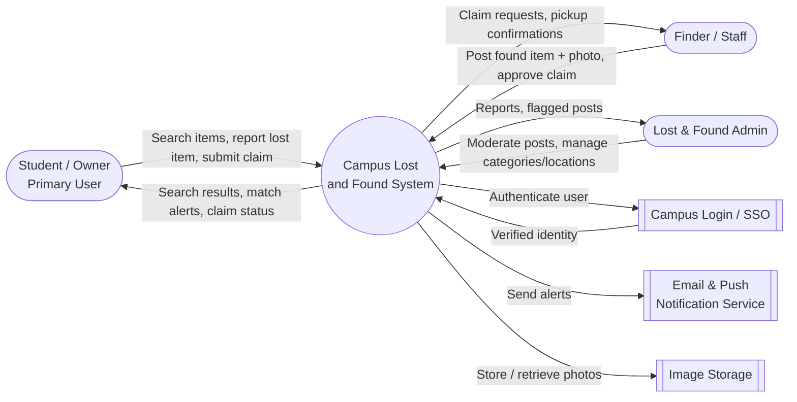
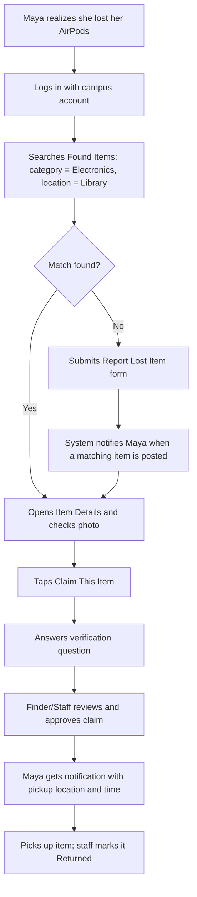
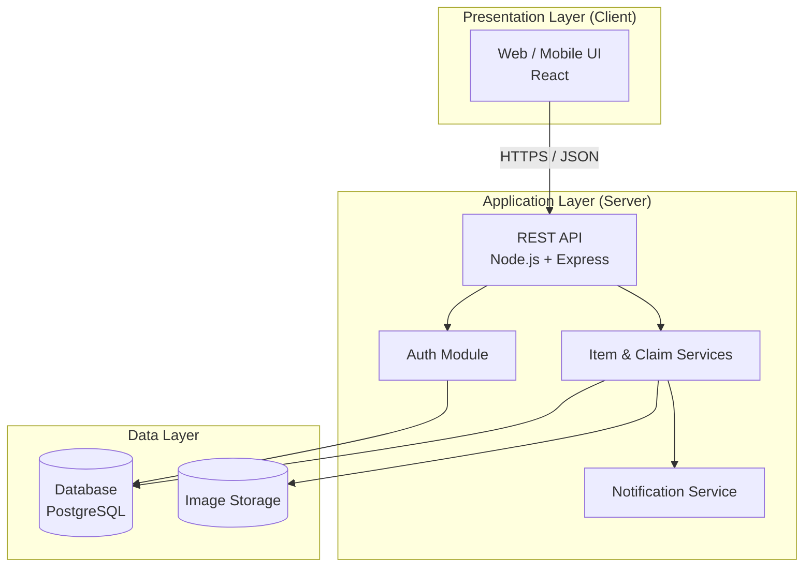

# Campus Lost and Found

**Product Goal:** Help students, faculty, and staff quickly report lost items, post found items, and get them back to their owners through one simple campus-wide app — reducing the time items sit unclaimed at scattered campus offices.

---

## Prototype

The prototype was designed using a user-centered approach. Every persona, diagram, screen, and flow below supports the Product Goal: getting lost items back to their owners quickly.

### 1. Personas

**Primary user — Maya Rodriguez, the Student Who Lost Something**
- **Age / Role:** 20, sophomore, commutes to campus four days a week
- **Tech comfort:** High; uses her phone for almost everything
- **Goal:** Find her lost AirPods / student ID / water bottle fast, without walking to multiple offices
- **Frustrations:** Doesn't know where to look first; lost-and-found boxes are spread across buildings; no way to know if someone has already turned her item in
- **Needs from the app:** Search found items by category, location, and date; post a "lost" report; get notified when a matching item is found; claim it easily

**Secondary user — James Carter, the Finder / Front Desk Staff**
- **Age / Role:** 34, front-desk staff at the library (also represents students who find items)
- **Tech comfort:** Medium
- **Goal:** Log found items quickly and hand them back to the right person
- **Frustrations:** Paper logs get messy; hard to verify that the person claiming an item actually owns it
- **Needs from the app:** A fast "post found item" form with photo upload; a way to review and approve claims; mark items as returned

### 2. Context Diagram

The context diagram shows the Campus Lost and Found system and the external actors it interacts with.



### 3. UI — Key Screens

The following key screens are represented in the prototype:

| Screen | Purpose |
|---|---|
| **Login** | Sign in with campus credentials so posts and claims are tied to real users |
| **Home / Browse** | Shows recently found items with search bar and filters (category, location, date) |
| **Item Details** | Photo, description, where/when it was found, and a **Claim This Item** button |
| **Report Lost Item** | Form for owners to describe what they lost so the system can alert them of matches |
| **Post Found Item** | Form with photo upload, category, location found, and pickup location |
| **Claim Form** | Owner answers a verification question (e.g., describe a unique detail) |
| **My Items / Notifications** | Tracks the user's lost reports, claims, and match alerts |

### 4. UX — Primary User Journey (Maya recovers her lost item)



**Important tasks the primary user accomplishes:** searching found items, reporting a lost item, claiming an item with verification, and receiving pickup notifications — all supporting the goal of getting items back fast.

---

## Architecture

The Campus Lost and Found app uses a **client–server architecture** with a **layered (three-tier) design**.



**Layers**
1. **Presentation layer (client):** The user interface handles screens, forms, and displaying results. It never talks to the database directly; it only calls the API.
2. **Application layer (server):** A REST API that holds the business logic:
   - *Auth module* – login with campus credentials, session/token handling
   - *Item service* – create, search, and update lost and found posts
   - *Claim service* – submit claims, verify ownership, approve/deny, mark returned
   - *Notification service* – sends email/push alerts when a match is found or a claim is approved
3. **Data layer:** A relational database storing Users, Items (lost/found), Claims, and Locations, plus a separate storage service for item photos.

**Why this structure:** Separating the layers keeps the UI, business rules, and data independent, so each part can be built and tested on its own (see Test Plan), and the client could later be swapped for a mobile app without changing the server.

---

## Test Plan

We will use **four categories of testing**: unit, integration, system (end-to-end), and usability.

### 1. Unit Testing
Tests individual functions and components in isolation.
- **Tools:** Jest (server and client), React Testing Library (UI components)

| ID | Test Case | Expected Result |
|---|---|---|
| U1 | Validate "Post Found Item" form with missing required fields | Form shows error and does not submit |
| U2 | Search filter by category returns only that category | Only matching items returned |
| U3 | Claim status changes from Pending → Approved | Status updates correctly |
| U4 | Date filter rejects a future date | Validation error shown |

### 2. Integration Testing
Tests that layers and services work together (API ↔ database ↔ notification service).
- **Tools:** Jest + Supertest against a test database

| ID | Test Case | Expected Result |
|---|---|---|
| I1 | `POST /items` with photo saves item to DB and image to storage | 201 Created; item retrievable via `GET /items/:id` |
| I2 | Approving a claim triggers a notification | Notification service called with owner's email |
| I3 | Unauthenticated request to `POST /claims` | 401 Unauthorized |

### 3. System / End-to-End Testing
Tests complete user journeys through the real UI, following the UX flow above.
- **Tools:** Cypress or Playwright

| ID | Scenario | Expected Result |
|---|---|---|
| S1 | Maya logs in, searches, claims an item, and sees pickup notification | Full flow completes with no errors |
| S2 | Finder posts a found item; it appears on Browse screen | New item visible to other users |
| S3 | Owner reports a lost item, then a matching found item is posted | Owner receives match alert |

### 4. Usability Testing
Checks that real users can complete key tasks using the prototype and the working app.
- **Method:** 3–5 students complete tasks while thinking aloud
- **Tasks:** Find a lost item, report a lost item, claim an item
- **Success criteria:** Each task completed in under 2 minutes without help; feedback is used to revise the UI

---

## Getting Started (new teammates)

1. **Clone** the repo and open it in VS Code:
   ```
   git clone https://github.com/barzd/capstone-project.git
   ```
2. **Backend** (Python 3.12+):
   ```
   cd backend
   py -m venv venv
   .\venv\Scripts\Activate.ps1        # macOS/Linux: source venv/bin/activate
   pip install -r requirements.txt
   ```
   Copy `backend/.env.example` to `backend/.env` and fill in `MONGODB_URI` (ask the database owner for a login) and `DJANGO_SECRET_KEY`. Then:
   ```
   python manage.py migrate
   python manage.py runserver 127.0.0.1:8000
   ```
3. **Frontend** (Node.js 22), in a second terminal:
   ```
   cd frontend
   npm install
   npm run dev
   ```
   Open **http://127.0.0.1:5173** (use `127.0.0.1`, not `localhost`, so login cookies work).

Optional setup guides: `backend/GOOGLE_OAUTH_SETUP.md`, `backend/FORGOT_PASSWORD_SETUP.md`, `backend/INVENTORY_TESTING_GUIDE.md`.

---

## CI/CD Pipeline

The workflow lives in [`.github/workflows/ci-cd.yml`](.github/workflows/ci-cd.yml) and runs automatically on **every push and every pull request to `main`** (it can also be started by hand from the **Actions** tab).

| Stage | What it does |
|---|---|
| **Setup** | Checks out the code, installs Python 3.13 and Node.js 22, and fails early if a required GitHub Secret is missing. |
| **Dependencies** | Installs backend packages (`pip install -r requirements.txt`) and frontend packages (`npm ci`), then caches them for the next stages. |
| **Test** | Runs `manage.py check` and the Django test suite (`python manage.py test items`), then builds the React frontend (`npm run build`) to catch compile errors. |
| **Deploy** | On pushes to `main` only (after Test passes), builds the frontend and publishes it to **GitHub Pages**: https://barzd.github.io/capstone-project/ |

Each stage only runs if the one before it passed. Pull requests run Setup, Dependencies, and Test; Deploy is skipped until the code is merged.

> **Note:** GitHub Pages hosts the frontend only. The Django backend and MongoDB run locally (see *Getting Started*), so features that need the backend (login, reports) work when running the app locally.

---

## Secrets

No passwords, API keys, or tokens are stored in the code or the workflow file.

- **Locally**, each developer keeps them in `backend/.env`, which is listed in `.gitignore` and never committed. `backend/.env.example` shows the variable names with no real values.
- **In the pipeline**, they come from **GitHub Secrets** (*Settings → Secrets and variables → Actions*):

| Secret | Used for |
|---|---|
| `MONGODB_URI` | MongoDB connection string Django needs to start |
| `DJANGO_SECRET_KEY` | Django's `SECRET_KEY` (previously hard-coded in `settings.py`; moved to an environment variable and replaced with a new key) |

Generate a new Django secret key with:
```
python -c "import secrets; print(secrets.token_urlsafe(50))"
```

**A .env file containing a database password was accidentally committed on Nov 3 (f258f02) and removed in the next commit. That password has been changed in MongoDB Atlas, so the copy in the history no longer works. The old Django SECRET_KEY was also replaced.**

---

## Branch Protection

`main` is protected by a GitHub **ruleset** (*Settings → Rules → Rulesets*):

1. **No direct pushes** to `main`; all changes go through a pull request.
2. **At least one approval** from a teammate is required before merging.
3. The **Test** stage of the CI/CD pipeline must pass before merging.

---

## Contributing Workflow

1. Pick an issue on the Kanban board and move it to **In Progress**.
2. Update your local `main`, then create a feature branch:
   ```
   git checkout main
   git pull
   git checkout -b short-feature-name
   ```
3. Make your changes and add or update a test for the story's acceptance criteria in `backend/items/tests.py`.
4. Commit and push, then open a pull request to `main` that links the issue (e.g. `Closes #12`).
5. Wait for the pipeline to turn green and for a teammate's approval, then merge. The Deploy stage publishes the update automatically.

---

## Feature Development

| Epic | User story | Pull request | Test(s) |
|---|---|---|---|
| Epic 1: User Accounts & Privacy | User Accounts | #__ | |
| Epic 1: User Accounts & Privacy | Password Recovery | #69 | |
| Epic 1: User Accounts & Privacy | Privacy Protection | #63 | `PrivacyProtectionTests` |
| Epic 2: ___ | ___ | #__ | |

---

## AI-Use Statement

## AI-Use Statement

We used **Claude** (Anthropic's AI assistant) as a helper throughout this submission. All AI-generated changes went through our normal process: a feature branch, a pull request, a teammate review, and the CI pipeline.

**How we used it**
- Drafted the GitHub Actions workflow (`.github/workflows/ci-cd.yml`) with the Setup, Dependencies, Test, and Deploy stages.
- Found that Django's `SECRET_KEY` was hard-coded in `settings.py` and helped move it into GitHub Secrets / `.env`.
- Scanned our commit history for secrets. It found a `.env` file with a real MongoDB password that had been committed and then deleted on Nov 3. We changed that password in MongoDB Atlas so the copy in the history no longer works.
- Wrote README sections (Getting Started, CI/CD Pipeline, Secrets, Branch Protection, Contributing Workflow).
- Helped write tests for user stories (e.g. `PrivacyProtectionTests`) and helped review teammates' pull requests.
- Explained Git steps (branching, merge conflicts, updating a branch from `main`).

**What the AI got wrong and how we fixed it**
1. **Deploy stage assumed GitHub Pages was enabled.** The first workflow published the frontend to GitHub Pages, but Pages was never turned on for the repo (only the owner can do that). After merging, the Deploy stage failed at "Configure GitHub Pages" with `Get Pages site failed ... Not Found`. We found it in the Actions log and changed Deploy to build the production frontend and report the deployment, with real hosting (Vercel + Render) planned for a later sprint.
2. **Outdated action version.** The workflow used `actions/cache@v4`, which targets the deprecated Node.js 20 runtime. We spotted the "Node.js 20 is deprecated" warnings in the run's annotations. It still runs, and we plan to upgrade it.
3. **Code based on an outdated file.** Outside the workflow itself, AI-generated dropdown changes were based on an older copy of the report forms. When a teammate merged them (PR #66), they would have removed the login/CSRF code added by the Privacy Protection PR, so submitting reports failed with "Authentication credentials were not provided." We caught it by testing the PR before merging and restored the code.

**What we learned:** AI output still has to be tested. Every problem above was caught by running the pipeline, reading the Actions logs, or testing a pull request before merging, not by trusting the generated code.
